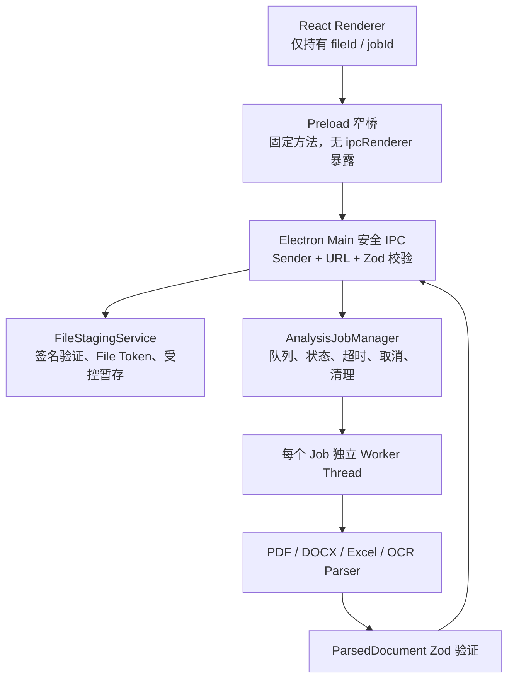

# REAL-AI-001B 统一解析服务与安全 IPC

## 1. 验收结论

REAL-AI-001B 已完成并通过技术验证。001A 的 PDF、DOCX、Excel、图片 OCR 解析器已迁移到受控 Electron 后台任务架构；Renderer 只接触 `fileId`、`jobId` 和经过运行时校验的公开结果，不接触本地路径、Node API 或原始 `ipcRenderer`。

本轮未接入 DeepSeek、产品库、产品匹配、数据库或公开平台搜索，也未接入现有 AI 智能接待业务页面。TASK-001 至 TASK-005 的冻结业务页面未在本轮修改。

## 2. 修改文件

### Electron 主进程与安全桥

- `electron/main.cjs`
- `electron/preload.cjs`
- `electron/real-ai/config.cjs`
- `electron/real-ai/errors.cjs`
- `electron/real-ai/file-staging-service.cjs`
- `electron/real-ai/index.cjs`
- `electron/real-ai/job-manager.cjs`
- `electron/real-ai/runtime-schemas.cjs`
- `electron/real-ai/temp-utils.cjs`
- `electron/real-ai/ipc/channels.cjs`
- `electron/real-ai/ipc/register.cjs`
- `electron/real-ai/smoke/harness.html`
- `electron/real-ai/smoke/run-smoke.cjs`

### Parser Worker 与 Renderer 类型客户端

- `src/real-ai/workers/parser-worker.ts`
- `src/real-ai/parsers/image-parser.ts`
- `src/real-ai/types/ipc-contracts.ts`
- `src/real-ai/types/index.ts`
- `src/real-ai/clients/electron-analysis-client.ts`

### 构建、测试与依赖

- `scripts/real-ai/build-worker.mjs`
- `scripts/real-ai/run-packaged-smoke.mjs`
- `electron/real-ai/tests/runtime-schemas.test.cjs`
- `electron/real-ai/tests/file-staging-service.test.cjs`
- `electron/real-ai/tests/job-manager.test.cjs`
- `package.json`
- `package-lock.json`
- `.gitignore`

新增生产依赖为 `zod`、`yauzl`、`@tesseract.js-data/chi_sim`；新增构建依赖为 `esbuild` 与 `@types/yauzl`。

## 3. 最终进程架构



选择 Worker Thread 而不是 Utility Process，原因是当前 001A 解析器均为 Node 模块，Worker Thread 能直接复用，并可通过 `terminate()` 可靠取消 OCR、扫描 PDF 和大型 Excel。每个 Job 使用独立 Worker，终止后可释放任务级内存，主进程不执行高负载解析。

## 4. Preload 与 IPC 接口

Renderer 仅可使用：

| API | 输入 | 输出 |
| --- | --- | --- |
| `realAI.files.select()` | 无 | `StagedFileToken[]` |
| `realAI.files.stage(files)` | 浏览器 `File[]/FileList` | `StagedFileToken[]` |
| `realAI.files.cleanup(fileIds)` | `fileId[]` | 清理结果 |
| `realAI.analysis.start(fileIds)` | `fileId[]` | `AnalysisJobSnapshot` |
| `realAI.analysis.cancel(jobId)` | `jobId` | 终态快照 |
| `realAI.analysis.status(jobId)` | `jobId` | 当前快照 |
| `realAI.analysis.cleanup(jobId)` | `jobId` | 清理结果 |
| `realAI.analysis.onProgress(listener)` | 回调 | 取消订阅函数 |

IPC 使用固定白名单 Channel。主进程同时验证授权 `webContents.id`、页面 URL、参数 Schema、`fileId` 和 `jobId` 格式。`../../xxx` 等路径穿越式 ID 会返回 `INVALID_REQUEST`。

## 5. File Token 机制

文件选择后，真实路径只在 Preload 到 Main 的单次受控调用中出现。主进程复制文件到随机暂存目录，生成内部 `FileSourceDescriptor`：

- `fileId`
- `displayName`
- `size`
- `declaredMimeType`
- `detectedType`
- `detectedMimeType`
- `stagedPath`
- `sha256`
- `createdAt`

返回 Renderer 的 `StagedFileToken` 会移除 `stagedPath` 和内部 MIME 信息。自动测试确认 Token、Job 快照和错误结果均不包含本机路径。

## 6. 文件安全验证

暂存前依次检查：

1. 扩展名白名单：PDF、DOCX、XLSX、XLS、JPG、JPEG、PNG。
2. 声明 MIME 与目标类型兼容性。
3. `file-type` Magic Bytes / 文件签名。
4. DOCX/XLSX ZIP 内部结构：`[Content_Types].xml` 与主文档入口。
5. Office 压缩包条目数、解压后总大小、单条压缩比限制。
6. 单文件大小、空文件、文件存在性检查。

伪装扩展名返回 `FILE_SIGNATURE_MISMATCH`，损坏结构返回 `FILE_CORRUPTED`。主进程不解压 Office ZIP 内容，仅检查目录结构和安全限额。

## 7. Job 状态机

```text
queued
  -> staging / copying-files
  -> parsing / reading-file | parsing-document | rendering-page
  -> ocr / recognizing-text
  -> normalizing / validating-result
  -> cleaning-up
  -> completed | failed | cancelled
```

进度使用“当前阶段 + 已完成文件数 / 总文件数”，不伪造无法准确计算的百分比。最多并发 3 个 Job；每个 Job 使用独立随机工作目录和 Worker。

终态只在资源清理完成后发布，因此订阅者看到 `completed`、`failed` 或 `cancelled` 时，`resourcesCleaned` 必定为 `true`。
终态结果默认保留 15 分钟供 Renderer 读取，随后自动从主进程内存移除；Renderer 也可以提前调用 `analysis.cleanup(jobId)`。

## 8. Runtime Schema

IPC 边界使用 Zod 验证：

- `FileSourceDescriptor`
- `StagedFileToken`
- `AnalysisJobSnapshot`
- `ParsedDocument`
- `AnalysisErrorResult`
- 所有请求参数

Worker 返回的 `ParsedDocument` 必须完整通过 Schema 后才能进入 Renderer。损坏或伪造的 Worker 结果不会直接进入页面层。

## 9. 超时、取消与错误恢复

集中配置位于 `electron/real-ai/config.cjs`：

- DOCX：60 秒
- XLS/XLSX：120 秒
- PDF：180 秒
- 图片 OCR：180 秒
- 最大并发：3

取消会标记 Job 进入终结流程、终止 Worker、清理 Job 目录和暂存文件，并返回 `JOB_CANCELLED`。终结锁会忽略 Worker 后续消息，防止取消后回写 `completed`。

超时会终止 Worker、返回 `PARSE_TIMEOUT` 并执行同一清理流程。Worker 异常退出或结果 Schema 失败统一转为结构化错误，不把堆栈、磁盘路径或客户资料内容返回 Renderer。

## 10. 临时文件生命周期

运行目录位于系统临时目录的 `shuyuan-real-ai` 下，包含 `staged`、`jobs`、`cache`。每个文件与 Job 使用随机独立目录。

- 成功：清理 Job 目录与源暂存文件。
- 失败：清理 Job 目录与源暂存文件。
- 取消：终止 Worker 后清理。
- 超时：终止 Worker 后清理。
- 启动：扫描并删除超过 24 小时的遗留目录。

日志不记录客户资料正文和完整磁盘路径。

## 11. OCR 不确定性

底层不会把 `9P-3000` 自动改写为 `SP-3000`。结果保留：

- OCR 原始文字
- 行级置信度
- 图片级平均置信度
- bbox / 来源位置
- `ocr_low_confidence`
- `ocr_character_ambiguity`

型号纠错与人工确认属于后续 REAL-AI-001C/001F，不在解析层擅自处理。

## 12. 开发环境测试

执行结果：

- `npm run test:real-ai`：7/7 通过。
- `npm run test:real-ai-service`：8/8 通过。
- `npm run check`：通过。
- `npm run build`：通过。
- `npm run smoke:real-ai:electron`：通过。

开发版 Smoke 数据：

| 项目 | 样本大小 | 结果 | 耗时 |
| --- | ---: | --- | ---: |
| PDF + DOCX + XLSX 三任务并发 | 9,754 + 8,933 + 16,500 B | 全部完成 | 723 ms |
| 中文图片 OCR | 69,362 B | 完成，置信度 0.90 | 975 ms |
| 扫描 PDF 取消 | 48,860 B | 渲染阶段取消成功 | 已验证 |
| 损坏 PDF | 脱敏异常样本 | `FILE_CORRUPTED` | 已验证 |

Renderer 心跳最大漂移 3.1 ms；Main 事件循环最大延迟 82.97 ms。测试期间 UI/Renderer 可持续执行心跳，未出现主线程阻塞。

## 13. Windows 打包 Smoke Test

执行：

- `npm run dist:win`：通过。
- `npm run smoke:real-ai:packaged`：通过。

打包版 Smoke 数据：

| 项目 | 结果 | 耗时 |
| --- | --- | ---: |
| PDF + DOCX + XLSX 三任务并发 | 全部完成 | 603 ms |
| 中文图片 OCR | 完成，置信度 0.90 | 915 ms |
| 扫描 PDF 取消 | `JOB_CANCELLED`，资源已清理 | 已验证 |
| Worker 失败恢复 | `FILE_CORRUPTED`，资源已清理 | 已验证 |

Renderer 心跳最大漂移 2 ms；Main 事件循环最大延迟 70.32 ms。Worker、WASM、中文语言包和 Tesseract 子 Worker 路径均存在并可运行，`staged` 与 `jobs` 目录在测试后为空。

## 14. Worker、WASM、语言包打包方案

- Parser Worker 使用 esbuild 输出单一入口到 `resources/real-ai/parser-worker.mjs`。
- `chi_sim.traineddata.gz` 作为 `extraResources` 放入 `resources/real-ai/tessdata`，OCR 不依赖网络下载。
- 仅精确 `asarUnpack` Canvas 原生模块、Tesseract Worker/Core/WASM 及其 Worker 运行所需传递依赖。
- 未解包整个 `node_modules`。
- Canvas 原生模块由 electron-builder 的 `@electron/rebuild` 按 Electron 43 x64 校验。

## 15. 已发现并修复的 Bug

1. Job 终态最初早于临时资源清理发布，快速订阅者可能拿到 `resourcesCleaned: false`。现已改为先清理、后发布终态。
2. Electron `contextBridge` 会丢弃自定义 `Error.code`。现改为传递冻结的结构化安全错误对象，错误码可稳定到达 Renderer。
3. 首次打包版 OCR 失败：Tesseract 子 Worker 位于 `app.asar.unpacked`，但其传递依赖仍在 ASAR 内。现已精确解包必要依赖，第二次打包 Smoke 通过。

## 16. 仍存在的风险

1. OCR 对型号字符仍可能误识别，例如 `SP-3000` 变为 `9P-3000`，必须保留人工确认。
2. 三个 OCR Job 同时运行时内存峰值可能明显高于当前小样本测试，需要用真实上限样本继续压测。
3. 简单 PDF 表格仍为启发式恢复，低置信度结果不可直接作为正式报价依据。
4. 当前单文件限制 25 MB、单批最多 10 个文件；正式上线前应依据客户典型资料重新校准。
5. 本轮只提供底层 API 和测试 Harness，尚未接入 AI 智能接待页面。
6. 当前为本地解析基础设施，不包含病毒扫描、内容脱敏、AI 调用或长期审计存储。

## 17. 是否建议进入下一阶段

建议进入 `REAL-AI-001D 本地企业产品库`，暂不直接进入 DeepSeek 结构化提取。先定义稳定、可导入、可版本化的本地产品数据结构，可为后续 001C 的提取字段和 001E 的匹配规则提供明确目标。

本报告完成后停止，不自动开始 REAL-AI-001C 或 REAL-AI-001D。
