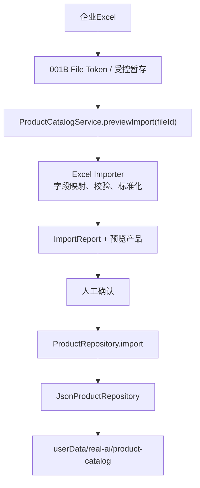

# REAL-AI-001D 本地企业产品库 V1

## 1. 验收结论

REAL-AI-001D 已完成。本轮建立了可真实导入、逐行校验、预览确认、版本化保存、离线查询和回滚的本地企业产品库。

产品运行时数据不再依赖 Excel、React 页面常量、`demoSalesFlow.ts` 或演示 JSON。Excel 仅作为导入媒介，确认后生成位于 Electron `app.getPath("userData")` 下的版本化 JSON，并统一通过 `ProductRepository` 访问。

本轮未接入 DeepSeek、产品匹配、数据库、1688 或正式产品库 UI；未修改 TASK-001 至 TASK-005、CORE-FLOW-003、AI 智能接待和其他冻结业务页面。

## 2. 修改文件

### 产品库核心

- `src/real-ai/catalog/contracts.ts`
- `src/real-ai/catalog/normalization.ts`
- `src/real-ai/catalog/schemas.ts`
- `src/real-ai/catalog/excel-importer.ts`
- `src/real-ai/catalog/json-product-repository.ts`
- `src/real-ai/catalog/product-catalog-service.ts`
- `src/real-ai/catalog/index.ts`

### 模板与黄金样本

- `assets/templates/企业产品库标准导入模板.xlsx`
- `src/real-ai/catalog/fixtures/sample-products.json`
- `src/real-ai/catalog/fixtures/standard-product-catalog.xlsx`
- `src/real-ai/catalog/fixtures/standard-product-catalog.xls`
- `src/real-ai/catalog/fixtures/standard-product-catalog-v2.xlsx`
- `src/real-ai/catalog/fixtures/alias-multisheet.xlsx`
- `src/real-ai/catalog/fixtures/merged-multirow-header.xlsx`
- `src/real-ai/catalog/fixtures/invalid-products.xlsx`
- `src/real-ai/catalog/fixtures/empty-catalog.xlsx`
- `src/real-ai/catalog/fixtures/README.md`

### 测试与构建

- `src/real-ai/catalog/tests/normalization.test.ts`
- `src/real-ai/catalog/tests/excel-importer.test.ts`
- `src/real-ai/catalog/tests/repository.test.ts`
- `src/real-ai/catalog/tests/service.test.ts`
- `electron/real-ai/catalog/smoke/run-catalog-smoke.cjs`
- `scripts/real-ai/build-catalog.mjs`
- `scripts/real-ai/generate-catalog-fixtures.mjs`
- `scripts/real-ai/run-catalog-smoke.mjs`
- `electron/main.cjs`：仅增加隔离的内部产品库 Smoke 入口，正常启动逻辑不变。
- `package.json`：增加产品库构建、测试、Smoke 和模板打包配置。
- `.gitignore`：忽略产品库运行时编译产物。

本轮没有安装新依赖。

## 3. 最终架构



Renderer 后续只能提交 `fileId` 和确认动作，不能读取 Excel 路径或 JSON 文件。AI 提取层和匹配引擎也不能直接读取 JSON，必须依赖 `ProductRepository`。

## 4. ProductRecord 最终结构

`ProductRecord` 只描述企业自己的产品，不包含报价、客户、库存或销售状态。

| 字段 | 说明 |
| --- | --- |
| `schemaVersion` | 当前为 `1.0` |
| `productId` | 稳定产品 ID |
| `productName` | 客户原始产品名称 |
| `model` | 客户原始型号 |
| `category` | 产品分类 |
| `specifications` | 标准化规格名到标准化值的快速查询 Map |
| `specificationDetails` | 每项规格的原始名、标准化名、原始值、标准化值、单位和基准值 |
| `applications` | 应用场景列表 |
| `keywords` | 关键词列表 |
| `synonyms` | 同义词列表 |
| `description` | 纯文本产品说明 |
| `status` | `active` / `inactive` |
| `version` | 单产品修订号 |
| `createdAt` / `updatedAt` | 创建与更新时间 |
| `source` | Excel、importId、文件显示名和 Sheet，不保存真实路径 |
| `sourceRow` | Excel 原始行号 |
| `normalizedName` | 标准化产品名 |
| `normalizedModel` | 标准化型号 |

### 4.1 规格结构

每个 `ProductSpecification` 同时保存：

- `rawName`
- `normalizedName`
- `rawValue`
- `normalizedValue`
- `unit`
- `baseValue`
- `baseUnit`
- `valueType`
- `parseStatus`

例如 `工作宽度 = 1.2m`：

- 原始值：`1.2m`
- 标准化值：`1200mm`
- 基准数值：`1200`
- 基准单位：`mm`

无法安全换算时，`parseStatus` 为 `raw`，原值保持不变，并生成 `SPECIFICATION_VALUE_UNNORMALIZED` 警告。

## 5. Excel 标准模板

基础列：

- 产品ID
- 产品名称
- 型号
- 分类
- 应用场景
- 关键词
- 同义词
- 产品说明
- 状态

规格采用普通员工可维护的动态列：

- `规格.工作宽度`
- `规格.功率`
- `规格.产能`
- `规格.尺寸`
- `规格.材质`
- `规格.重量`
- `规格.容量`

可以继续增加 `规格.xxx`，不要求填写 JSON。安装包中已包含模板：

`resources/real-ai/templates/企业产品库标准导入模板.xlsx`

## 6. 字段映射机制

支持三类映射：

1. 标准列精确映射。
2. 本地别名规则映射。
3. 调用方显式字段映射。

已覆盖示例：

- 产品名称 / 品名 / 商品名称 / `product_name`
- 型号 / 规格型号 / `model_number`
- 应用场景 / 应用 / `applications`
- 产品说明 / 描述 / `description`

支持中文、英文和中英文混合列名，也支持多 Sheet、隐藏 Sheet、合并单元格和两行表头。隐藏 Sheet 默认跳过并生成警告。

本轮没有使用 AI 自动映射。

## 7. ImportReport

正式导入流程：

```text
选择Excel
→ 001B生成fileId
→ 解析与字段映射
→ 逐行校验
→ ImportReport预览
→ 人工确认
→ 新产品库版本
```

`ImportReport` 包含：

- `importId`
- `sourceFile`
- `status`
- `totalRows`
- `successRows`
- `warningRows`
- `failedRows`
- `errors`
- `warnings`
- `rows`
- `fieldMappings`
- `previewRecords`
- `createdAt`
- `committedAt`
- `catalogVersion`

每条问题包含 `sheet`、`row`、`column`、`field`、`code`、`message` 和严重级别。V1 采用严格确认策略：只要存在失败行或错误，整个预览不能提交，当前版本完全不变。

## 8. Product ID 策略

1. Excel 提供合法 `productId` 时保留原 ID。
2. 未提供 ID 且有型号时：`企业命名空间 + normalizedModel` 计算 SHA-256，生成 `prd_` 加 16 位摘要。
3. 未提供型号时：`企业命名空间 + normalizedName` 生成稳定 ID。

因此 `SP3000`、`SP-3000` 和 `SP 3000` 会得到相同稳定 ID。产品名称调整不会改变有型号产品的自动 ID。

限制：无型号产品如果修改名称，会被视为新产品。正式管理 UI 后续需要提供“沿用旧 ID”或人工合并能力。

## 9. 标准化策略

导入时执行：

- Unicode NFKC
- 全角半角统一
- Unicode 连字符统一
- 英文字母大小写统一
- 多余空格归一
- 常见中英文标点归一
- 型号分隔符移除
- 关键词、同义词、应用场景拆分与去重

原始名称、型号、规格名和值始终保留，不会用标准化结果覆盖客户原始数据。

## 10. 单位处理策略

V1 只处理确定性单位：

- 长度：`mm`、`cm`、`m`，基准单位 `mm`
- 质量：`g`、`kg`，基准单位 `g`
- 功率：`W`、`kW`，基准单位 `W`

行业单位、区间、组合尺寸、速度和产能不强行换算。例如 `3000件/天` 保持原值，留给后续单位引擎和人工确认。

## 11. ProductRepository

正式接口提供：

- `list(filter?)`
- `getById(productId)`
- `findByNormalizedModel(model)`
- `searchCandidates(query)`
- `import(records, context)`
- `getVersionInfo()`
- `getCurrentSnapshot()`
- `getPreviousSnapshot()`
- `rollbackPrevious()`

`searchCandidates` 仅进行型号、名称、关键词、同义词、应用和分类的基础召回排序，不输出匹配度，不属于 REAL-AI-001E 匹配引擎。

未来 `SqliteProductRepository` 只需实现相同接口，页面、AI 提取层和匹配引擎无需直接感知存储迁移。

## 12. JSON 存储方式

正式目录：

```text
app.getPath("userData")/
  real-ai/
    product-catalog/
      manifest.json
      versions/
        catalog-v1.json
        catalog-v2.json
        catalog-v3.json
```

运行数据不写入 `resources`、`src`、`public` 或安装目录。Windows 应用升级不会覆盖 `userData`。

每个版本包含：

- catalogVersion
- createdAt
- import / rollback 来源
- 产品数组
- SHA-256 checksum

读取时通过 Zod Schema 和 checksum 双重验证。

## 13. 版本、原子提交与回滚

每次成功确认：

1. 写入随机临时文件。
2. `fsync` 刷盘。
3. 原子重命名为不可变版本文件。
4. 重新读取并校验 Schema 与 checksum。
5. 原子更新 `manifest.json` 当前/上一版本指针。

导入失败不会调用 Repository，也不会改变 manifest。写入失败会清理临时文件。

Repository 使用进程内写锁，两个并发确认会串行生成不同版本号。

回滚不会修改旧版本，而是将上一版本内容复制为新的审计版本。例如 V2 回滚后生成 V3，V3 的来源记录 `restoredFromVersion: 1`。

## 14. 安全边界

- Excel 导入通过 001B `fileId` 和受控暂存服务。
- Renderer 不获取真实路径。
- 只接受通过扩展名、MIME、Magic Bytes 和 Office ZIP 结构验证的 XLS/XLSX。
- SheetJS 不执行公式；公式单元格按空值处理并提示。
- 不加载宏、外部资源或公式依赖。
- 产品说明保存为字符串；未来 UI 必须按文本渲染，禁止直接使用 `dangerouslySetInnerHTML`。
- ImportReport 与 ProductRecord 不保存本地绝对路径。

## 15. 测试产品库

黄金库包含 24 条脱敏工业产品，覆盖：

- `SP-3000` 自动喷涂设备标准方案
- `AL-2600` 自动化生产线基础方案
- `FP-980` 家具配件喷涂方案
- 同系列不同型号
- 相似产品名
- 同义词与关键词
- 不同规格与单位写法
- 不同应用场景

异常样本覆盖：空 Excel、无 Sheet、缺少名称、缺少型号、重复 ID、重复型号、型号产品冲突、同名不同型号、非标准单位、超长文本、隐藏 Sheet、合并单元格、多行表头、中文列名、英文列名和混合列名。

## 16. 自动测试结果

- `npm run test:real-ai`：7/7 通过。
- `npm run test:real-ai-service`：8/8 通过。
- `npm run test:real-ai-catalog`：20/20 通过。
- `npm run check`：通过。
- `npm run build`：通过。
- 开发版产品库双进程 Smoke：通过。

开发 Smoke 验证：

1. 标准 Excel 导入 24 条。
2. 生成 catalogVersion 1。
3. 关闭 Electron。
4. 使用相同隔离 `userData` 重新打开。
5. 查询 `SP-3000` 成功。
6. 导入 V2，生成 catalogVersion 2。
7. 回滚，生成 catalogVersion 3。
8. 回滚后内容与 V1 一致。

## 17. Windows 打包测试结果

- `npm run dist:win`：通过。
- `npm run smoke:real-ai:catalog:packaged`：通过。
- `npm run smoke:real-ai:packaged`：通过，确认没有破坏冻结的 001B。

打包版实际验证：

- `packaged: true`
- 标准模板导入 24 条
- 关闭重开后当前版本仍为 1
- `SP-3000` 查询成功
- V2 导入成功
- 回滚生成 V3
- 产品数仍为 24
- 存储路径位于 `userData/real-ai/product-catalog`
- 打包资源中存在标准 Excel 模板

Smoke 使用独立临时 `userData`，完成后自动删除，没有触碰开发机现有业务数据。没有执行真实安装器覆盖或重新安装测试，以避免影响已验证的 Windows 演示版数据；架构层面运行数据与安装目录已完全分离。

## 18. 已发现并修复的 Bug

1. SheetJS ESM 入口不能直接使用内部 `writeFile` 保存模板。已改为生成 Buffer，再由 Node `fs/promises` 写盘。
2. 如果发布终态前不校验版本文件，磁盘异常可能留下不可读取版本。现改为写入后重新读取、Schema 校验和 checksum 校验，再切换 manifest。
3. 同时确认两个导入可能争用版本号。现增加 Repository 进程内写锁，并加入并发回归测试。
4. 删除空白行会导致 ImportReport 行号偏移。现保留工作表物理行，再跳过空行，报告行号与 Excel 一致。

## 19. 尚存风险

1. 当前写锁只覆盖单 Electron 进程；如果未来允许多个应用实例同时操作同一 `userData`，需要进程级文件锁或单实例约束。
2. 无型号产品以标准化名称生成 ID，名称修改可能形成新产品。
3. V1 对重复标准化型号采取严格阻断；某些行业可能允许不同分类复用型号，需要企业级策略配置。
4. JSON Repository 会整库载入内存，产品达到数千至数万条、需要频繁增量编辑时应迁移 SQLite。
5. 本地 JSON 当前为明文，依赖操作系统用户目录权限；对高度敏感产品资料可在后续评估本地加密。
6. 单位引擎只覆盖基础长度、质量和功率，复杂行业单位仍需扩展。
7. 本轮没有正式产品库管理 UI，也没有长期导入审计页面。

## 20. 与后续 AI 和匹配引擎的契约

后续必须保持：

```text
ExtractedProduct
→ MatchEngine
→ ProductRepository.searchCandidates / findByNormalizedModel
→ Candidate Products
→ 分层匹配判断
→ 人工确认
```

REAL-AI-001C 只负责结构化提取，不能读取 JSON。REAL-AI-001E 负责精确型号、名称/同义词、规格、应用场景和语义判断，不能绕过 Repository。

## 21. 是否建议进入 REAL-AI-001C

建议在产品经理验收 REAL-AI-001D 后进入 REAL-AI-001C。产品库契约、规格证据结构、标准化型号和 Repository 查询边界已经稳定，可以作为 AI 结构化输出的明确目标。

本报告完成后停止，不自动开始 REAL-AI-001C 或 REAL-AI-001E。
